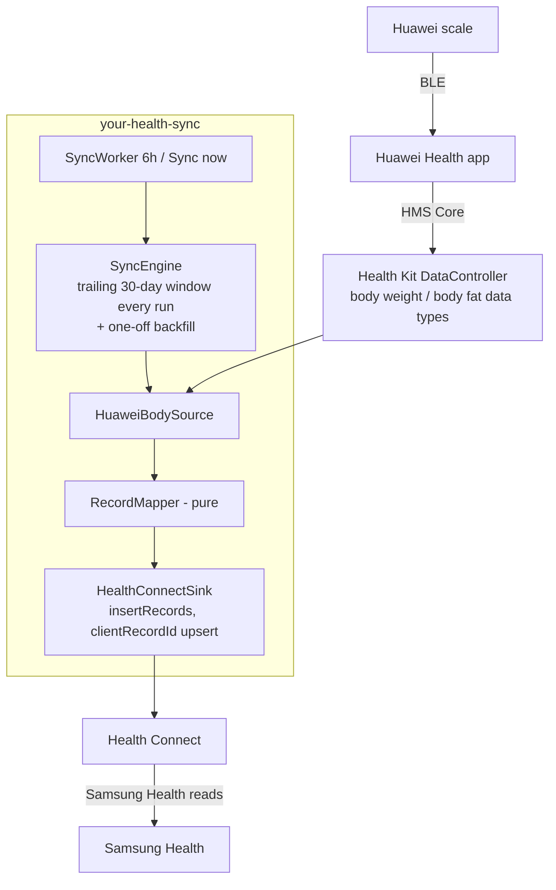

# Design: Huawei Health → Health Connect → Samsung Health (body composition)

Status: approved 2026-11-23.

## Context
The user wants their Huawei Health weight and body-composition data to show up in Samsung Health on one Samsung phone, without paying for Health Sync. Research found no open-source tool that does this sync on an ongoing basis:
- christianeirich/huawei-health-to-health-connect (MIT): a one-off migration via the privacy-center data export, a Python script and Tasker.
- MrClayPole/huawei-health-connect-sync (MIT): Health Kit to Health Connect, but steps only and manual.

So we build our own open-source Android app, written from scratch, using MrClayPole's `HuaweiHealthGateway.kt` only as a reference for the Health Kit call pattern.

Decisions the user made:
- Approach: on-device Huawei Health Kit, writing to Health Connect.
- Data: full body composition.
- Audience: personal use first, distributed as an APK on GitHub Releases.
- Sync: periodic background sync plus a "Sync now" button.
- The user already has a verified Huawei developer account.

## Distribution model (why "personal first" works)
Huawei binds Health Kit access to one App ID, package name and signing fingerprint. Users install **the user's signed APK from GitHub Releases**. Anyone building from source must register their own app and apply for the scopes; the README says this up front. Huawei's docs say applying grants test scopes for up to 100 users before full review passes. **Unverified:** whether those scopes are usable right after applying or only after the review. Check the scope status in the console right after submitting; this doesn't change the build order. Full review (needed past 100 users) asks for an in-app privacy statement, a way to revoke authorization and a demo video, so the app includes the first two from day one.

## Step 0: Huawei application (user acts in the console; I write a checklist first)
1. Create the AppGallery Connect app with package **`io.github.wallwallfacer.yourhealthsync`** (confirmed by the user). Register the SHA-256 fingerprints of the release key and the debug key.
2. Apply for Health Service Kit scopes: **height & weight read** and **body fat read**. Body fat is a separate scope family covering fat rate, BMI, muscle, water, bone, protein and skeletal muscle. Also request a historical-data scope if the console offers one. Before submitting, check in the console that these scope names are correct.
3. Privacy statement: `PRIVACY.md` in the repo, served via GitHub Pages and linked in the app within 4 taps. The developer name in it must match the Huawei account.
4. On the phone: install AppGallery, then HMS Core, then Huawei Health. In Huawei Health, enable Health Kit data sharing.

## Data mapping (pure function with unit tests; check the field names against the SDK)
| Huawei data | Health Connect record | Shows in Samsung Health? |
|---|---|---|
| body weight (kg) | WeightRecord | yes |
| body fat rate (%) | BodyFatRecord | yes |
| basal metabolism (kcal/day) | BasalMetabolicRateRecord | yes |
| bone salt (kg) | BoneMassRecord | no (stays in HC only) |
| moisture / water (kg) | BodyWaterMassRecord | no (stays in HC only) |
| BMI, visceral fat, muscle/skeletal muscle, protein, body age, score | dropped (no HC type) | n/a |

Lean body mass is not derived (my call: we don't write a value the scale never measured). Samsung's support table comes from Samsung's dev blog and may change between versions; the Samsung-side spike confirms it.

**Idempotency:** `clientRecordId = "huawei:<type>:<epochMillis>"`, where epochMillis is the Huawei sample's own timestamp, so the ID is stable. `clientRecordVersion = MAPPING_VERSION`, a constant bumped whenever the mapping changes, so a mapper fix rewrites old records. An equal version is likely ignored by Health Connect; to be checked against the HC docs. Every run re-reads a **trailing 30-day window**, which catches scale data uploaded late. There is no cursor and no ledger. Backfill is a separate one-off action that reads history in chunks. Each record's zone offset is the device zone's offset at the measurement instant (Huawei samples carry only epoch time).

## Project layout (Kotlin, single `:app` module; implementation calls: Compose UI, WorkManager, DataStore, coroutines)
- `settings.gradle.kts`, `build.gradle.kts`, `app/build.gradle.kts`: Huawei maven repo `https://developer.huawei.com/repo/`, `com.huawei.hms:health` (latest), `androidx.health.connect:connect-client` (latest stable), minSdk 28, target/compile 35.
- `app/src/main/AndroidManifest.xml`: the HC permissions `WRITE_WEIGHT`, `WRITE_BODY_FAT`, `WRITE_BASAL_METABOLIC_RATE`, `WRITE_BONE_MASS`, `WRITE_BODY_WATER_MASS`; the permissions-rationale activity alias Health Connect requires; the HMS appid meta-data, injected from `local.properties` via a manifest placeholder and never committed.
- `.../huawei/HuaweiAuth.kt`: `SettingController.requestAuthorizationIntent(scopes, true)`.
- `.../huawei/HuaweiBodySource.kt`: reads in windows of 30 days or less. It doesn't assume one Huawei data type: it reads whatever types hold each metric (e.g. `DT_INSTANTANEOUS_BODY_WEIGHT`, `DT_INSTANTANEOUS_BODY_FAT_RATE`, to be checked against the SDK) and emits independent per-metric samples `(metric, epochMillis, value)`.
- `.../model/BodySample.kt`, `.../sync/RecordMapper.kt`: pure code. No joining across metrics is needed, because IDs are per type.
- `.../hc/HealthConnectSink.kt`: permission check, `insertRecords`.
- `.../sync/SyncEngine.kt` (trailing window + backfill chunks), `.../sync/SyncWorker.kt` (periodic 6h, needs network).
- `.../ui/MainActivity.kt`: a single screen showing Huawei auth status, HC permission status, the last sync time and count, a "Sync now" button, a "Backfill history" button, a "Revoke Huawei access" button (`SettingController` cancel-authorization), and a link to the privacy statement.
- `app/src/test/...`: `RecordMapperTest`, `SyncEngineTest` (fake source and sink, testing window bounds, backfill chunking, partial-field measurements, and that an error in one chunk doesn't abort the others).
- `README.md`: setup for forkers (own App ID, fingerprint, scopes, `local.properties`), plus the Samsung Health step: Settings → Health Connect → allow reading body composition.
- `LICENSE`: MIT (my call; it matches the prior art).
- `PRIVACY.md`: the privacy statement (GitHub Pages).
- `.github/workflows/ci.yml`: build and unit tests only. CI-built APKs can't authenticate with Huawei, because the runner's key isn't registered.
- `docs/superpowers/specs/2026-11-23-huawei-to-health-connect-design.md`: this design, committed.

## Execution order (thin slice first)
1. `git init`, write the design doc and the Huawei application checklist, and commit. Create the **release keystore now** (`keytool`, stored outside the repo, e.g. `~/.android/yourhealthsync-release.jks`, password in Keychain), because step 0 registers its SHA-256. The user submits the Huawei application right away, since review takes about 10–15 working days.
2. Toolchain: `brew install gradle`, then `gradle wrapper`. JDK: `JAVA_HOME=$(brew --prefix openjdk@17)`. SDK 35 is already installed.
3. **Samsung-side spike (no Huawei needed):** a debug screen inserts one record of each of the 5 types into Health Connect, using the user's **real latest weigh-in values** (no fake numbers in real Samsung data). Add one extra Weight record dated **60+ days back**. Checks, done over adb on the phone:
   - (a) What the Health Connect app and Samsung Health show.
   - (b) Whether the 60-day-old record reaches Samsung. Health Connect limits a reading app to roughly 30 days before its permission grant. If it doesn't arrive, backfill only fills Health Connect, and the README says so.
   - (c) Delete one record in Health Connect and see whether Samsung drops its copy.
   If Samsung reads nothing, stop and re-plan.
4. TDD: `RecordMapper`, then `SyncEngine` with fakes.
5. **Thin Huawei slice:** auth, a one-window read and a manual Sync now. Run it on the device as soon as the test scopes are active. This is the first check that HMS on Samsung works.
6. Then the full composition, the worker, backfill, revoke, privacy link, README and CI. Commit.
7. Release APK signed with the user's keystore (kept outside the repo) and published on GitHub Releases. Fixes found on the device go in separate commits.

## Verification
- Local: `./gradlew testDebugUnitTest lintDebug assembleDebug` all green.
- On the device (Samsung, over `adb install`):
  1. Grant Huawei and HC permissions.
  2. Weigh in on the scale and see the reading in Huawei Health.
  3. Tap Sync now. The Health Connect app should show Weight, Body fat and the other records, with this app as the source.
  4. Samsung Health should show the weigh-in.
  5. Tap Sync now again. There should be no duplicates.
  6. Wait for the periodic run, or force it with `adb shell cmd jobscheduler run`. It should sync a new weigh-in.
- Backfill: on a fresh install, "Backfill history" should import past weigh-ins, as far back as the Huawei history scope allows.

## Risks / fallbacks
- **Samsung Health may not read from Health Connect** (some users report one-way sync). The step-3 spike finds out before any Huawei work.
- **Huawei might reject the scope or refuse an individual developer.** Fallback: an importer for the privacy-export ZIP, using the same mapper and sink with a different source.
- **HMS Core on Samsung may be flaky.** Fallback: the Health Kit REST API (same approval, OAuth in the browser, no on-device HMS), with the same mapper and sink.
- **History depth and query-span limits are unverified.** Handled by chunking and the history scope.
- **Huawei reads may not work from a background worker** (HMS might require the app in the foreground). Checked in step 5 by forcing the job. Fallback: sync when the app opens, plus the manual button.
- **Rollback (partly unverified):** every record carries this app as its data origin, so Health Connect's "Delete app data" removes everything it wrote there. Whether Samsung Health then drops its own copy is unknown; spike check (c) answers it.

## Non-goals
- Deletions in Huawei are not propagated to Health Connect (the sync only adds and updates).
- No writes back to Huawei, and no other data types (steps, sleep, heart rate).
- No Play Store or F-Droid listing for now.
